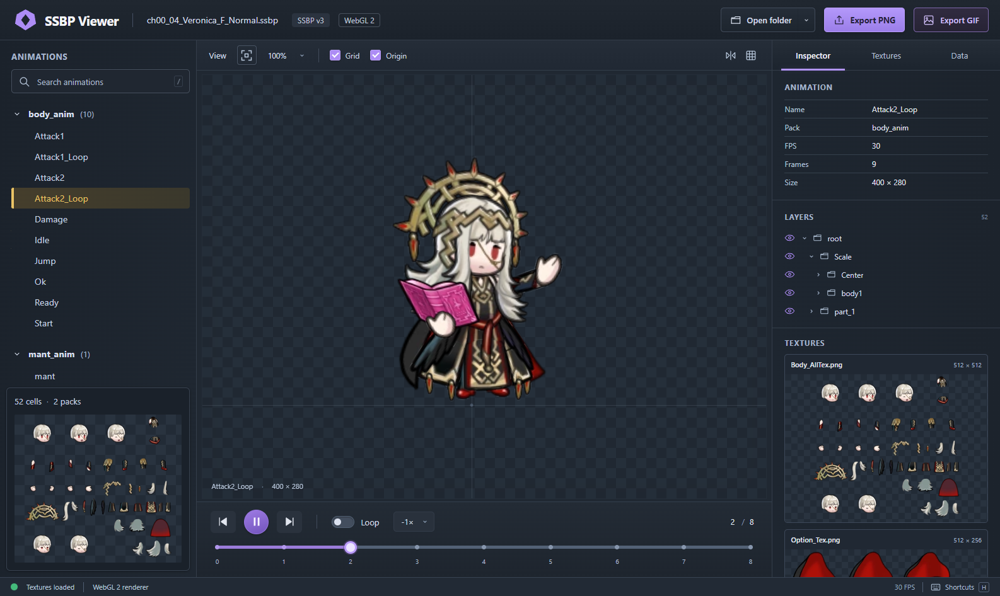

# SSBP Viewer

A browser-based SpriteStudio SSBP animation viewer with a standalone TypeScript library. The original C++ viewer is preserved in `ssbp-Viewer-0.1` as a reference.



## Getting started

Requirements: Node.js 22.12 or later and npm with workspace support.

```sh
npm install
npm run dev
```

Open **http://127.0.0.1:5173/**. The Veronica example loads automatically. Select **Open folder** or drag a folder containing an `.ssbp` file and its textures into the viewer. The menu next to the button lets you select multiple files or reload the example. If a folder contains multiple SSBP files, the viewer lets you choose one.

Files are processed locally in your browser. They are not uploaded to a server, and no external services or remote fonts are required.

## The two packages

| Package                           | Contents                                                                                                    |
| --------------------------------- | ----------------------------------------------------------------------------------------------------------- |
| [`@ssbp/core`](packages/ssbp)     | SSBP v3 binary reader, typed data, frame evaluation, instances, effects, and a platform-independent player. |
| [`@ssbp/viewer`](packages/viewer) | React + Vite application and a WebGL 2 renderer with custom shaders.                                        |

The library does not depend on the DOM, React, or WebGL. The viewer consumes its public API. Fixed-point position conversion (`DOT = 10`) takes place in the library; textures are rendered with WebGL 2. Canvas 2D is not used, including for PNG export.

## Controls

- Play, pause, previous and next frame, timeline, and frame number input.
- Loop and playback speed, including reverse playback.
- Drag to pan, scroll to zoom, and double-click to fit the view.
- Transparency grid, origin, horizontal flip, and wireframe.
- Part inspector with hierarchy, visibility, and current-frame properties.
- Expandable texture atlases with cell overlays.
- Export the visible area as a transparent PNG, the entire animation as a GIF, or project data as JSON.
- C++ viewer shortcuts: Space, A/S, arrow keys, L, X, C, W, Q, and 1/2/3. Select **Shortcuts** to see the list.

Zoom is relative to the fitted view: **100%** fits the character inside the viewport. Exported PNGs include the renderer's visible area at screen resolution, without panels, the grid, or origin markers.

**Export GIF**, next to **Export PNG**, saves every frame of the selected animation from first to last. It preserves the framing, visible layers, horizontal flip, speed (including reverse playback), and loop setting. A dialog shows progress and lets you cancel without losing the current frame or playback state. Encoding runs in a local Web Worker using the WebGL framebuffer, without Canvas 2D. GIF limits each frame to 256 colors and binary transparency; timing is rounded to hundredths of a second. Use PNG to preserve partial alpha and full color.

## Publishing to GitHub Pages

The repository includes [`.github/workflows/pages.yml`](.github/workflows/pages.yml). This workflow installs dependencies, runs tests, builds both packages, and publishes **only** `packages/viewer/dist`.

1. Push the project files and workflow to the repository's default branch (`master` or `main`). Include `package-lock.json` and the files in `packages/viewer/public/demo`.
2. On GitHub, open **Settings → Pages → Build and deployment → Source** and select **GitHub Actions**.
3. Under **Actions**, run **Deploy SSBP Viewer to GitHub Pages → Run workflow**, or push another change to the default branch.
4. The workflow run will show the published URL. For this repository, the expected address is **https://didix16.github.io/ssbpViewerJs/**.

Assets and the GIF worker use relative paths, so the application works under `/ssbpViewerJs/`, in another repository, or on a custom domain. Subsequent pushes to the default branch publish automatically. No personal access token or separate server is required. Files you open in the viewer are processed in your browser, even when the application is hosted on Pages.

`npm run build` also generates `packages/viewer/dist`, which can be deployed to any static host. Publishing the TypeScript files from `src` directly is not sufficient.

## Building and verification

```sh
npm run typecheck
npm test
npm run build
npm run preview
```

Build output is written to `packages/ssbp/dist` for the library and `packages/viewer/dist` for the static application. The latter can be hosted by any static HTTP server, including under a subdirectory.

Browser tests start their own server on port 5174, verify WebGL, PNG alpha export, search, controls, hierarchy, atlases, local file loading, and mobile layout, and save screenshots to `test-results`:

```sh
npx playwright install chromium
npm run test:browser
```

You can also use an existing Chromium installation by setting `SSBP_BROWSER_PATH`.

`npm run test:pages` builds the application and serves it under `/ssbpViewerJs/`, matching GitHub Pages. It checks asset and worker loading, along with frame count, duration, transparency, reverse order, looping, and cancellation of exported GIFs.

## Compatibility and example assets

**SSBP binary version 3** is supported; other versions produce an explicit error. Implemented features include normal and null parts, nested instances, XYZ transforms, pivots, vertex deformation, UVs, color and alpha blending, labels, and user data. Reserved text fields from the C++ runtime can be inspected but do not produce text sprites.

The example has 52 cells, two packs, 11 animations, and 306 frames in total. Its `Body_AllTex.png` and `Option_Tex.png` files contain **WebP** data: the loader detects their headers. The `wep_mg.png` and `eff_WepSwing.png` weapon textures are included in `public/demo/Wep`. For your own projects, you can place them in a `Wep` folder alongside `tex`: the loader also matches unique filenames. The viewer reports any remaining missing texture references.

Effect reading and command simulation have synthetic tests. The example contains no effects, so complex particle fidelity still needs validation against real files. See the [format and porting notes](docs/architecture.md).
